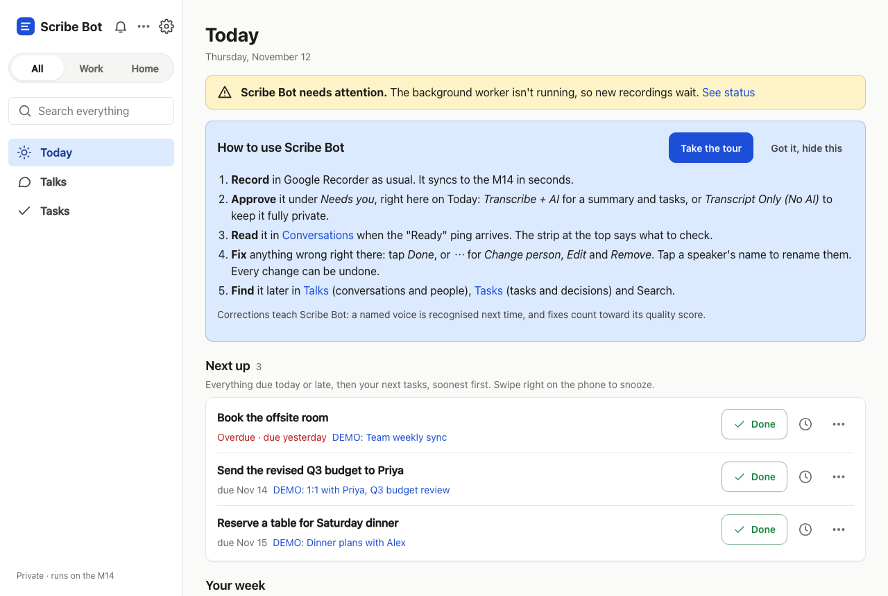
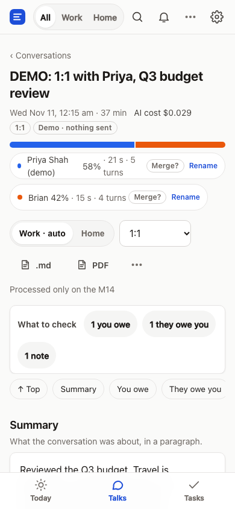
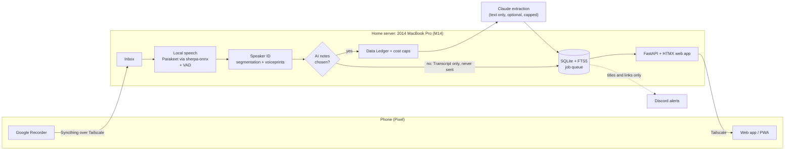

# Scribe Bot

A private, self-hosted app that turns recorded conversations into searchable transcripts, tasks, decisions, and
notes about people. Speech-to-text runs on my own hardware, so the audio never leaves home. I built it with Claude
Code, and it runs on a 2014 MacBook Pro at home.

> This repo is the public version. It has the full app code and tests, plus made-up sample meetings so you can try it
> in Demo mode. My real recordings, transcripts, and setup notes stay in a separate private repo.

| Today (laptop) | A conversation (phone) |
| --- | --- |
|  |  |

Screenshots are from Demo mode: made-up meetings only. More in [`docs/screenshots/`](docs/screenshots/).

## The problem

I have a lot of conversations at work and at home, and promises and details get lost. Recording is easy. Turning a
45-minute recording into "who owes what by when" is the hard part, and most tools that do it send your audio to
someone else's cloud.

## What it does

- **Captures** recordings from my phone automatically (Google Recorder files sync to the home server), or one at a
  time with Share > Scribe Bot.
- **Transcribes locally** with Parakeet speech recognition (sherpa-onnx) on the server, separates speakers, and
  recognizes known voices from voiceprints, asking me to confirm unsure matches.
- **Extracts** a title, summary, tasks with owners and due dates ("you owe" and "they owe you"), decisions, and notes
  about people, using Claude on the transcript text only. Meetings marked **Transcript only** never go to any AI
  (AI notes can still be made later, on request).
- **Asks first.** Each new recording waits in the Inbox with its length, an estimated processing time, and an estimated
  AI cost: AI notes, Transcript only, Remind me later, Delete, or Process at a set time. Overnight, recordings still
  waiting get a transcript with no AI. Every outbound AI call is written to a Data Ledger, and spend has hard monthly caps.
- **Web app** (installable on phone and desktop): Today, Conversations (click any line to play from that word),
  People, Tasks (swipe to finish or snooze), Search, Costs, Status, Settings. Exports to Markdown or PDF.
- **Stays up on its own:** every processing step saves its output, so jobs resume after a crash or power cut;
  nightly encrypted backups with a monthly restore test; one-command deploys that roll back if the health check fails.

## How it works



- Audio and speech processing stay on the server. Only transcript text of meetings chosen for AI notes goes to the AI, and
  only after the cost estimate passes the caps.
- There are no open ports: phone and laptop reach the web app over Tailscale.
- Discord gets alerts (server health, backups, spend, a new recording waiting), never meeting content.

## Stack

| Layer | Choice |
|---|---|
| Language | Python 3.12, managed with `uv` |
| Web | FastAPI, server-rendered HTMX, hand-written CSS, installable PWA |
| Data | SQLite with FTS5 full-text search; SQLite-backed job queue and scheduler |
| Speech | sherpa-onnx: Parakeet TDT recognition, VAD, speaker segmentation and embeddings |
| AI | LiteLLM router (Anthropic, Google, OpenAI), Claude Sonnet by default, pinned version |
| Secrets | macOS Keychain (never in the database, logs, backups or git) |
| Sync and access | Syncthing (phone to server), Tailscale |
| Services | launchd |
| Backups | restic + rclone to Google Drive, monthly restore test |
| Notifications | Discord webhook (alerts only) |
| Quality | pytest, GitHub Actions on synthetic data, gitleaks pre-commit hook |

## Try it on the web

The same Demo mode can run on Vercel with made-up meetings only: no keys, no AI calls, and changes reset on their own.
How it's set up: [`docs/VERCEL.md`](docs/VERCEL.md).

## Run it yourself (Demo mode)

Demo mode needs no phone, accounts, keys, speech models, or audio. It creates a separate `demo-data/` folder with
made-up meetings (invented people and text) and serves the web app on your machine.

```sh
# needs uv: https://docs.astral.sh/uv/
git clone https://github.com/branmuffn/scribe-bot-demo.git
cd scribe-bot-demo
scripts/demo.sh          # then open http://127.0.0.1:8000
```

Or step by step:

```sh
uv sync
uv run python -m scribe_bot.demo_data ./demo-data
SCRIBE_BOT_DATA=./demo-data uv run python -m scribe_bot.web
```

In Demo mode you can browse the sample meetings, open people and tasks, search, edit lines, swipe rows for quick actions,
and see the Data Ledger and Costs pages. Processing new audio needs the speech models and the worker, which are set up
by the `scripts/setup/` helpers on a real server. To start over, delete `demo-data/`.

## Tests

```sh
uv run pytest
```

The suite runs on synthetic data only and fakes the Keychain and macOS system commands, so it runs on Linux CI too.
GitHub Actions runs the tests and a gitleaks secret scan on every push.

## Responsible use

Recording people has legal and ethical rules, and they differ by place.

- **Consent.** Some states, including Massachusetts, require the consent of everyone in a conversation before it is
  recorded. Tell people you are recording and get their OK, or don't record.
- **Consent-first design.** Audio stays on your own devices. Meetings marked Transcript only never reach a cloud AI. Every
  item shows where it was processed, every outbound AI call is in the Data Ledger, and anything can be deleted.
  Nothing is ever sent or posted on your behalf.
- **Your accounts, your policies.** If you use it for work, check your employer's rules on recording and on AI tools.
- This is not legal advice.

## How it was built

I built Scribe Bot by directing Claude Code, one small, tested step at a time, with
a written spec and a decision log. The highlights are in [`docs/HOW_IT_WAS_BUILT.md`](docs/HOW_IT_WAS_BUILT.md).

## License

MIT. See [LICENSE](LICENSE).
